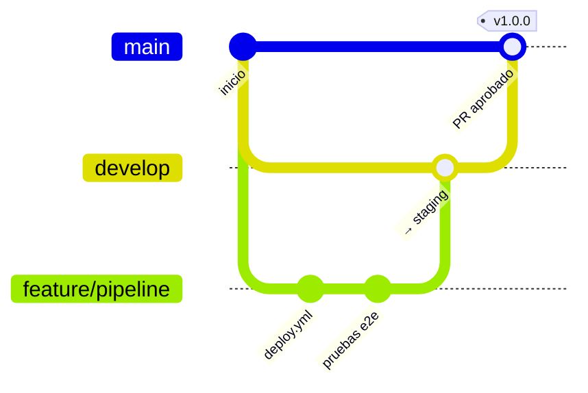
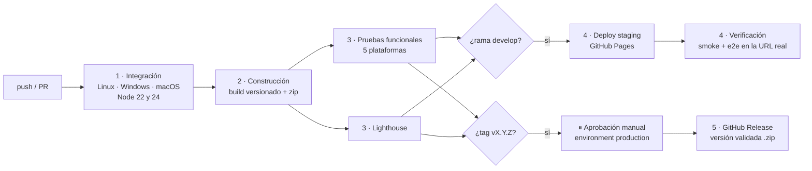

# Informe de práctica DevOps — Tareas PWA

> **Alumno:** _[tu nombre]_ · **Materia:** _[materia]_ · **Fecha:** _[fecha]_
> **Repositorio:** `https://github.com/hectorjua28/devops`
> **Ambiente de pruebas (staging):** `https://hectorjua28.github.io/devops/`

---

## 1. Descripción del sistema

**Tareas PWA** es un gestor de tareas web **multiplataforma** construido como *Progressive Web App* con **Vite + JavaScript puro**:

- Se ejecuta en cualquier navegador moderno (Chrome, Edge, Firefox, Safari) y en escritorio, Android e iOS.
- Es **instalable** (manifest + íconos) y **funciona sin conexión** gracias a un *service worker*.
- Guarda las tareas en `localStorage`, tiene modo claro/oscuro y diseño responsivo.
- El pie de página muestra **versión, commit y ambiente** del build, lo que permite verificar qué versión está desplegada.

## 2. Organización de carpetas y archivos

```
tareas-pwa/
├── .github/
│   ├── workflows/deploy.yml      ← pipeline CI/CD
│   └── pull_request_template.md  ← checklist de cada PR
├── docs/
│   ├── INFORME.md                ← este documento
│   ├── GUIA-CONFIGURACION.md     ← pasos para configurar GitHub
│   └── evidencias/               ← capturas de pantalla
├── public/                       ← archivos estáticos de la PWA
│   ├── manifest.webmanifest
│   ├── sw.js                     ← service worker (offline)
│   └── icons/
├── scripts/generate-icons.mjs    ← genera los íconos PNG
├── src/
│   ├── main.js                   ← interfaz (DOM)
│   ├── tasks.js                  ← lógica pura (probada unitariamente)
│   ├── storage.js                ← persistencia
│   ├── theme.js                  ← modo claro/oscuro
│   └── style.css
├── tests/
│   ├── tasks.test.js             ← pruebas unitarias (Vitest)
│   └── e2e/
│       ├── tareas.spec.js        ← pruebas funcionales (Playwright)
│       └── pwa.spec.js           ← pruebas de PWA: manifest, SW, offline
├── index.html
├── lighthouserc.json             ← umbrales de calidad (Lighthouse CI)
├── playwright.config.js          ← matriz multiplataforma
├── vite.config.js
└── package.json
```

La lógica de negocio (`tasks.js`) está separada de la interfaz (`main.js`) y del almacenamiento (`storage.js`), lo que permite probarla sin navegador.

## 3. Estrategia de ramas (Git Flow simplificado)

| Rama | Propósito | Qué hace el pipeline |
|---|---|---|
| `feature/*` | Desarrollo de cada cambio | Integración (pruebas + build) |
| `develop` | Integración y **ambiente de pruebas** | CI completa + **despliegue a staging** + verificación |
| `main` | Código estable, listo para liberar | CI completa (protegida: solo por PR) |
| Tag `vX.Y.Z` | **Versión validada** | CI completa + **aprobación manual** + GitHub Release |



Reglas de protección configuradas en `main` y `develop`: requieren Pull Request y que los *checks* del pipeline estén en verde antes de hacer *merge*.

## 4. Pipeline CI/CD (`.github/workflows/deploy.yml`)



| # | Job | Descripción |
|---|---|---|
| 1 | **Integración** | Matriz de 6 combinaciones (3 sistemas operativos × 2 versiones de Node). Instala dependencias con `npm ci`, ejecuta las pruebas unitarias y un build de verificación. |
| 2 | **Construcción** | Genera **un único build** con versión (`1.0.0-rc.N` en staging, `1.0.0` en producción), commit y ambiente incrustados. Lo entrega como artefactos `dist` y `tareas-pwa-<versión>.zip`, junto con `build-info.json`. |
| 3 | **Pruebas funcionales** | Playwright ejecuta 14 pruebas sobre **ese mismo artefacto** en Chromium, Firefox, WebKit (Safari), Pixel 7 e iPhone 14. Publica el reporte HTML con capturas. |
| 3 | **Lighthouse** | Audita rendimiento, accesibilidad, buenas prácticas y SEO. El pipeline falla si accesibilidad o buenas prácticas bajan de 90. |
| 4 | **Deploy staging** | Solo en `develop`. Publica el artefacto en GitHub Pages (environment `github-pages`). |
| 4 | **Verificación staging** | Espera a que la URL sirva el commit nuevo (`build-info.json`), hace una prueba de humo de los recursos de la PWA y repite las pruebas e2e **contra la URL real**. |
| 5 | **Release producción** | Solo con tags `v*.*.*`. Se detiene hasta que un revisor **apruebe** el environment `production`, y luego crea un GitHub Release con el `.zip` validado y notas automáticas. |

## 5. Proceso de Entrega Continua (CD) implementado

1. **Disparo automático:** cada `push` a `develop` ejecuta el pipeline sin intervención manual.
2. **Build once, deploy many:** la aplicación se construye **una sola vez** por ejecución. Las pruebas funcionales, Lighthouse y el despliegue usan exactamente el mismo artefacto, de modo que lo que se prueba es lo que se publica.
3. **Compuertas de calidad:** el despliegue solo ocurre si pasan la integración en los 3 sistemas operativos, las pruebas funcionales en las 5 plataformas y los umbrales de Lighthouse (`needs:` en el YAML).
4. **Ambiente de pruebas:** la versión candidata (`-rc.N`) se publica en GitHub Pages y queda disponible por HTTPS, requisito de los service workers.
5. **Verificación posterior al despliegue:** el pipeline comprueba que la URL pública sirve el commit desplegado y vuelve a correr las pruebas funcionales sobre el sitio real.
6. **Liberación controlada:** para producción se crea un tag `vX.Y.Z` desde `main`. El job queda **en espera de aprobación** (*Required reviewers*). El revisor valida el staging (pruebas, Lighthouse, instalación en dispositivos) y aprueba. Entonces se genera el **Release** con el paquete listo para publicarse en cualquier hosting estático.
7. **Trazabilidad:** cada build muestra versión, commit y ambiente en el pie de página y en `build-info.json`, que enlaza con la ejecución de Actions que lo generó.

## 6. Pruebas

### 6.1 Unitarias (Vitest) — 10 pruebas
Creación, alta, cambio de estado, eliminación, limpieza, filtros y estadísticas de tareas (`tests/tasks.test.js`).

### 6.2 Funcionales e2e (Playwright) — 14 pruebas × 5 plataformas

| Prueba | Verifica |
|---|---|
| carga la página principal | título, encabezado, estado vacío, contador |
| agrega tareas y actualiza el contador | alta, orden, contador, limpieza del input |
| no agrega tareas vacías | validación |
| marca una tarea como hecha y filtra | toggle, filtros Todas/Pendientes/Hechas |
| elimina una tarea | borrado con animación |
| las tareas persisten al recargar | `localStorage` |
| el texto se muestra sin interpretar HTML | protección contra inyección (XSS) |
| cambia entre modo claro y oscuro | tema |
| muestra versión, commit y ambiente | trazabilidad del build |
| captura de evidencia multiplataforma | screenshot en cada plataforma |
| el manifest es válido e instalable | `name`, `display`, íconos 192/512 existentes |
| tiene las etiquetas meta para móviles | viewport, theme-color, apple-touch-icon |
| service worker se registra y controla la página | SW activo con el scope correcto |
| funciona sin conexión | recarga y uso de la app en modo offline |

### 6.3 Resultados

| Suite | Resultado |
|---|---|
| Unitarias | _[10/10 ✅ — captura]_ |
| e2e chromium / firefox / webkit / mobile-chrome / mobile-safari | _[completar con la ejecución de Actions]_ |
| Lighthouse (rendimiento · accesibilidad · buenas prácticas · SEO) | _[ej. 100 · 100 · 100 · 100]_ |
| Verificación de staging | _[✅ — captura]_ |

> En la ejecución local de preparación: 10/10 unitarias, 28/28 e2e (Chromium escritorio + Pixel 7) y Lighthouse 100 en las cuatro categorías.

## 7. Evidencias de funcionamiento multiplataforma

| Plataforma | Evidencia |
|---|---|
| Linux / Windows / macOS | Job *Integración* en verde en los 3 SO (captura) |
| Chrome, Firefox, Safari (WebKit) | Jobs *Pruebas funcionales* + capturas del reporte |
| Android (Pixel 7) / iPhone 14 | Proyectos `mobile-chrome` / `mobile-safari` + capturas |
| Android real | Captura: Chrome → "Instalar app" y la app en la pantalla de inicio |
| iPhone real | Captura: Safari → Compartir → "Agregar a inicio" |
| Escritorio | Captura: ícono de instalar en Chrome/Edge y la app en ventana propia |
| Offline | Captura con modo avión activado y la app funcionando |

Ver `docs/evidencias/`.

## 8. Problemas encontrados y soluciones aplicadas

| # | Problema | Causa | Solución |
|---|---|---|---|
| 1 | El proyecto incluía `node_modules` y `dist` generados en Windows (binarios `*-win32-*`) | Se copiaron carpetas generadas | `node_modules/` y `dist/` en `.gitignore`. El pipeline usa `npm ci` para instalar las dependencias de cada SO desde `package-lock.json` |
| 2 | Vitest intentaba ejecutar las pruebas de Playwright | Vitest toma por defecto todos los `*.spec.js` | Se limitó `test.include` a `tests/**/*.test.js` y se excluyó `tests/e2e/**` en `vite.config.js` |
| 3 | En GitHub Pages la app vive en `/<repo>/`; las rutas absolutas (`/manifest.webmanifest`, `/sw.js`) darían 404 | Pages publica en una subruta | Build con **base relativa** `VITE_BASE=./`. Manifest y SW ya usaban rutas relativas. Probado sirviendo la app desde una subcarpeta: 28/28 pruebas OK |
| 4 | Al probar el build en subruta con `vite preview` todas las pruebas fallaban | `vite preview` también necesita la misma `base` | En CI se usa `E2E_USE_DIST=1` (sirve el artefacto) y para staging `E2E_BASE_URL` (prueba la URL real) |
| 5 | El modo offline/service worker no es confiable en Firefox y WebKit dentro de Playwright | Limitación de la herramienta de automatización, no de la app | Las pruebas de SW/offline corren en motores Chromium (escritorio y Android). En Safari/iOS se documenta con captura en un dispositivo real |
| 6 | Lighthouse ya no tiene categoría "PWA" | Se eliminó en Lighthouse 12 | Los requisitos PWA se validan con pruebas propias (`pwa.spec.js`) y Lighthouse audita las otras 4 categorías |
| 7 | Vitest 5 no soporta Node 20 (y Node 20 llegó a fin de vida) | Requisito `engines` de las herramientas | Matriz con Node 22 y 24 y `engines: >=22.12` en `package.json` |
| 8 | Justo después de desplegar, la URL podía servir aún la versión anterior | Propagación/caché de GitHub Pages | Paso que consulta `build-info.json` hasta encontrar el commit nuevo antes de las pruebas de verificación |
| 9 | _[Ej.: "Branch develop is not allowed to deploy to github-pages"]_ | _Regla de ramas del environment `github-pages`_ | _Settings → Environments → github-pages → agregar `develop`_ |
| 10 | _[Agrega aquí los errores reales que te salgan en Actions]_ | | |

## 9. Verificación antes de la liberación a producción

Lista que el revisor completa antes de aprobar el environment `production`:

- [ ] Todos los jobs del pipeline en verde para el commit a liberar.
- [ ] Staging accesible y con la versión `-rc` correcta en el pie de página.
- [ ] Reporte de Playwright sin fallas en las 5 plataformas.
- [ ] Lighthouse ≥ 90 en accesibilidad y buenas prácticas.
- [ ] Instalación probada en Android/iPhone y en escritorio.
- [ ] Prueba manual en modo offline.

## 10. Conclusiones

_[Redacta 1 o 2 párrafos con lo aprendido: automatización, calidad, trazabilidad, etc.]_
